# Báo cáo đánh giá mô hình SVM – Tuần 6

**Đã hoàn thành:** dự đoán trên tập test, xuất dự đoán từng mẫu, tính Accuracy / Precision / Recall / F1, trích xuất và vẽ ma trận nhầm lẫn, so sánh trực quan bốn cấu hình SVM đã lưu.

Lần đánh giá hoàn tất: **2026-10-03T16:25:55+07:00**. Mở [báo cáo HTML](index.html) bằng trình duyệt để xem toàn bộ bảng và hình, hoặc xem các bảng dưới đây.

## 1. Tập kiểm thử

| Nội dung | Số mẫu |
|---|---:|
| Train đã dùng ở Tuần 4–5 | 3428 |
| Test ban đầu | 858 |
| Loại vì trùng văn bản sau tiền xử lý với train | 2 |
| Loại vì trùng trong phần test còn lại | 0 |
| Tổng số dòng bị loại | 2 |
| **Test được đánh giá** | **856** |
| Nhãn 0 – Đáng tin cậy | 711 |
| Nhãn 1 – Không đáng tin cậy | 145 |

Dữ liệu gốc được giữ nguyên. [Danh sách dòng bị loại](tables/test_data_audit.csv) và [tập test được giữ](tables/evaluated_test_samples.csv) được lưu riêng. Mọi cấu hình được đánh giá trên cùng tập test sau kiểm tra. Pipeline đã lưu chỉ transform TF-IDF và predict; không fit lại trên test.

Train có **1 nhóm văn bản sau tiền xử lý giống nhau nhưng nhãn mâu thuẫn (0/1)**. Đây là giới hạn chất lượng nhãn cần nêu trong báo cáo; lần đánh giá này giữ nguyên các mô hình đã huấn luyện. Xem [các dòng có nhãn mâu thuẫn](tables/train_label_conflicts.csv).

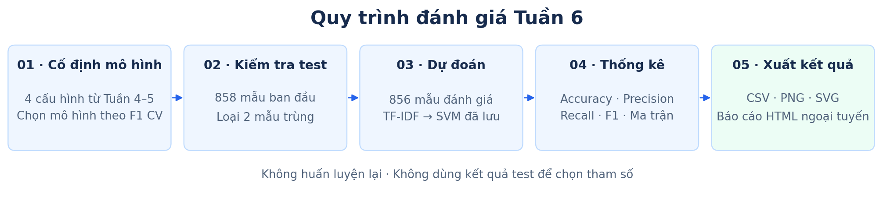

## 2. Mô hình đã chọn và chỉ số hiệu năng

Mô hình **RBF tối ưu** được chọn theo **F1 CV = 59.34%** từ Tuần 4–5, trước khi đánh giá test. Tham số: `kernel=rbf; C=10.0; gamma=0.01; class_weight=balanced`. Kết quả test dùng để đánh giá và không dùng để chọn lại mô hình hoặc tham số.

Nhãn dương là **1 = Không đáng tin cậy**; Precision, Recall và F1 dưới đây tính cho nhãn 1. Accuracy tính trên tất cả mẫu.

| Cấu hình SVM | Accuracy | Precision nhãn 1 | Recall nhãn 1 | F1 nhãn 1 | F1 macro | F1 weighted | Balanced accuracy |
|---|---:|---:|---:|---:|---:|---:|---:|
| Linear cơ sở | 87.50% | 78.79% | 35.86% | 49.29% | 71.08% | 85.49% | 66.95% |
| RBF cơ sở | 86.10% | 88.24% | 20.69% | 33.52% | 62.88% | 82.29% | 60.06% |
| Linear tối ưu | 85.63% | 56.18% | 68.97% | 61.92% | 76.53% | 86.19% | 79.00% |
| RBF tối ưu **(chọn theo CV)** | 83.76% | 51.49% | 71.72% | 59.94% | 74.88% | 84.76% | 78.97% |

`svm_best_model.pkl` là bản lưu của cấu hình chọn theo CV, không phải cấu hình thứ năm.

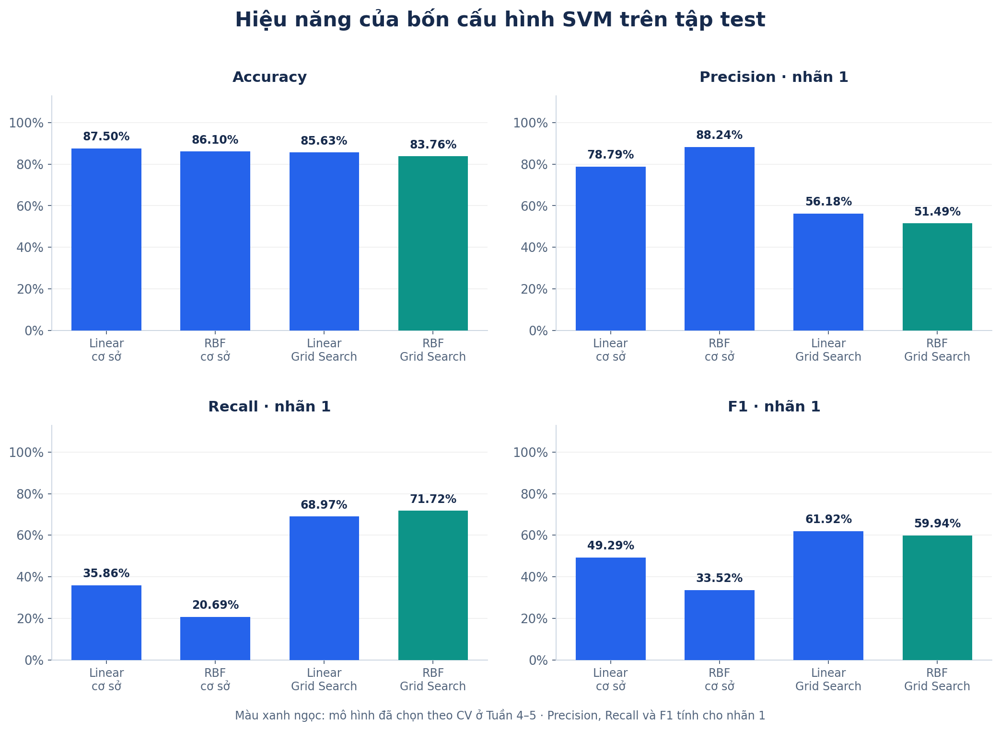

## 3. Ma trận nhầm lẫn

**Hàng = nhãn thực; cột = nhãn dự đoán**, theo thứ tự nhãn `[0, 1]`:

| Nhãn thực / Nhãn dự đoán | 0 – Đáng tin cậy | 1 – Không đáng tin cậy |
|---|---|---|
| 0 – Đáng tin cậy | TN | FP |
| 1 – Không đáng tin cậy | FN | TP |

FP là mẫu nhãn 0 bị báo thành nhãn 1; FN là mẫu nhãn 1 bị bỏ sót thành nhãn 0. Ma trận chuẩn hóa chia mỗi ô cho tổng hàng, nên mỗi hàng cộng thành 100%.

| Cấu hình SVM | TN | FP | FN | TP | Tổng lỗi |
|---|---:|---:|---:|---:|---:|
| Linear cơ sở | 697 | 14 | 93 | 52 | 107 |
| RBF cơ sở | 707 | 4 | 115 | 30 | 119 |
| Linear tối ưu | 633 | 78 | 45 | 100 | 123 |
| RBF tối ưu | 613 | 98 | 41 | 104 | 139 |

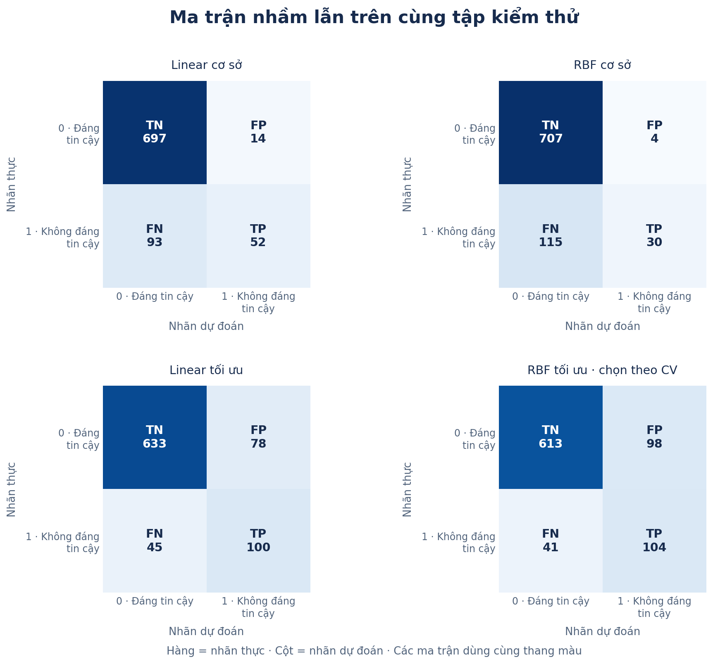

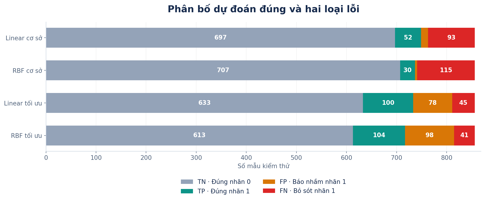

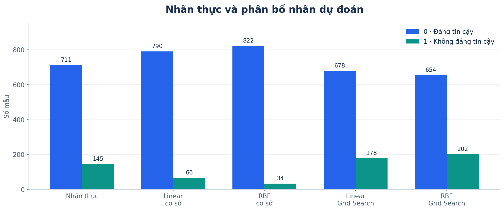

## 4. Đối chiếu với Cross Validation

| Cấu hình SVM | F1 CV | F1 test | Test − CV (điểm %) |
|---|---:|---:|---:|
| Linear cơ sở | 49.57% | 49.29% | -0.29 |
| RBF cơ sở | 33.66% | 33.52% | -0.14 |
| Linear tối ưu | 58.69% | 61.92% | +3.23 |
| RBF tối ưu | 59.34% | 59.94% | +0.60 |

CV là trung bình các folds trên train, còn test là một tập độc lập sau kiểm tra trùng lặp. Các chênh lệch là thống kê mô tả; không xếp hạng lại hoặc chọn cấu hình dựa trên test.

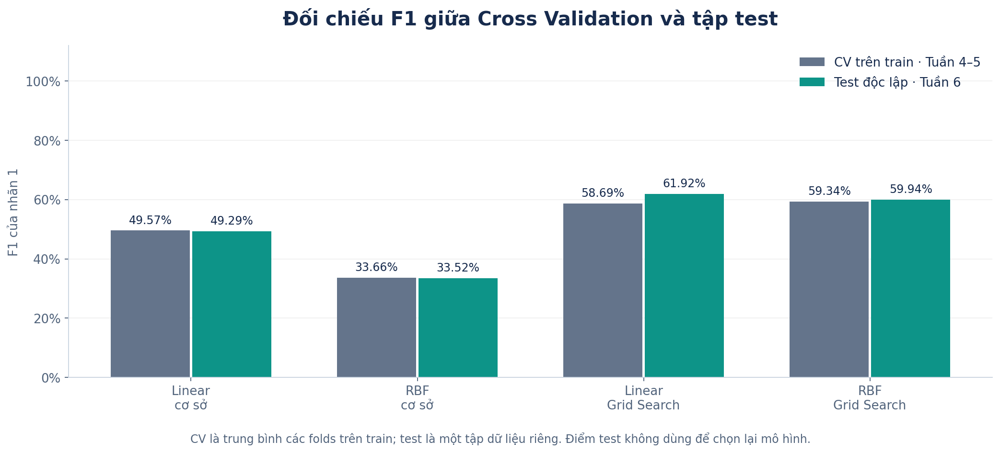

## 5. Báo cáo chi tiết từng cấu hình

### Linear cơ sở

Tham số: `C=1.0; kernel=linear; gamma=scale; class_weight=None`.

| Nhãn / cách lấy trung bình | Precision | Recall | F1 | Support |
|---|---:|---:|---:|---:|
| 0 · Đáng tin cậy | 88.23% | 98.03% | 92.87% | 711 |
| 1 · Không đáng tin cậy | 78.79% | 35.86% | 49.29% | 145 |
| Trung bình macro | 83.51% | 66.95% | 71.08% | 856 |
| Trung bình có trọng số | 86.63% | 87.50% | 85.49% | 856 |

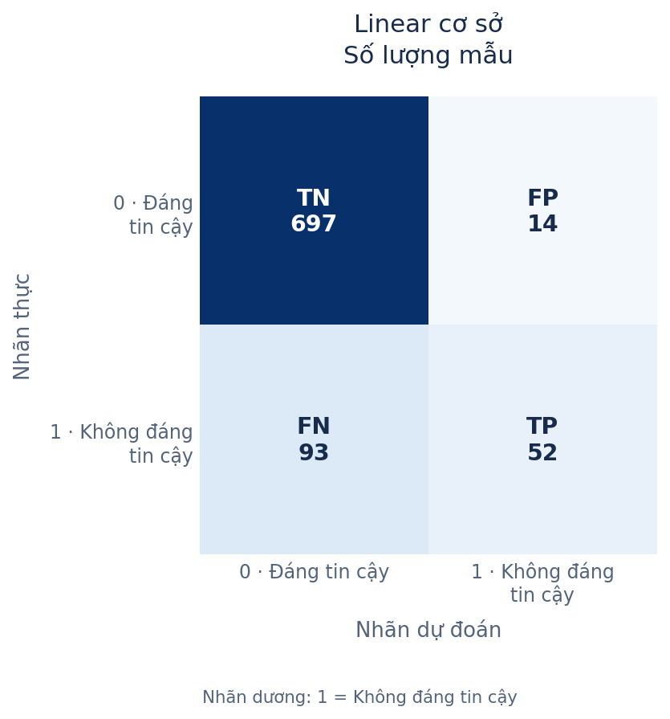

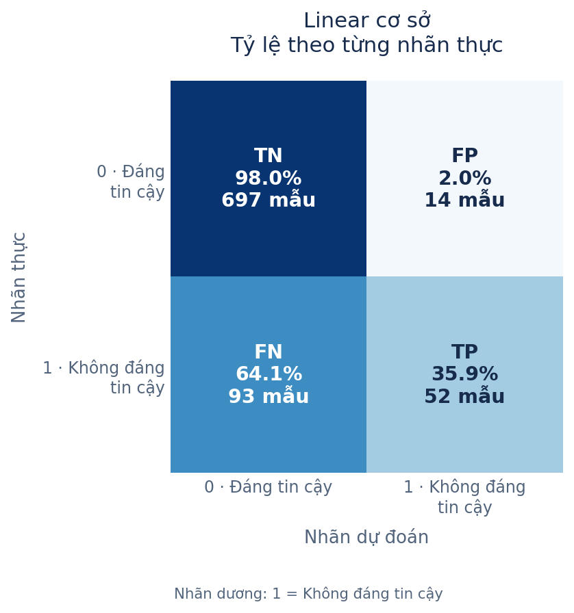

[Dự đoán từng mẫu](predictions/svm_linear_baseline.csv) · [Các mẫu dự đoán sai](predictions/svm_linear_baseline_errors.csv) · [Mô hình .pkl](../artifacts/svm_linear_baseline.pkl)

### RBF cơ sở

Tham số: `C=1.0; kernel=rbf; gamma=scale; class_weight=None`.

| Nhãn / cách lấy trung bình | Precision | Recall | F1 | Support |
|---|---:|---:|---:|---:|
| 0 · Đáng tin cậy | 86.01% | 99.44% | 92.24% | 711 |
| 1 · Không đáng tin cậy | 88.24% | 20.69% | 33.52% | 145 |
| Trung bình macro | 87.12% | 60.06% | 62.88% | 856 |
| Trung bình có trọng số | 86.39% | 86.10% | 82.29% | 856 |

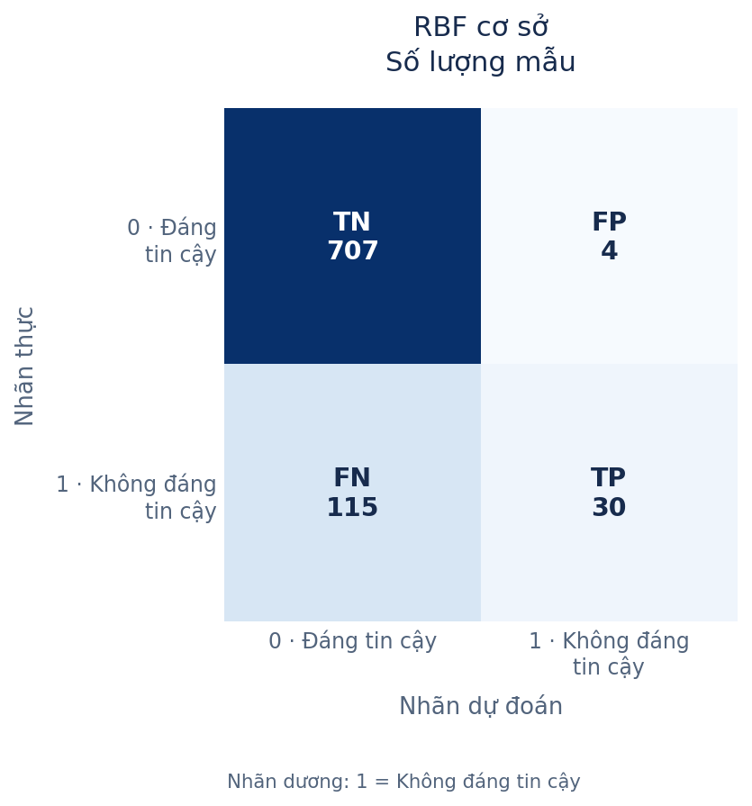

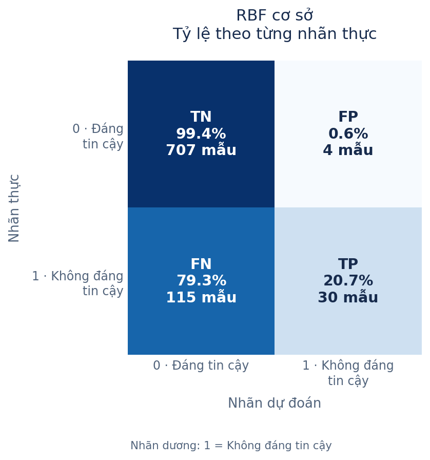

[Dự đoán từng mẫu](predictions/svm_rbf_baseline.csv) · [Các mẫu dự đoán sai](predictions/svm_rbf_baseline_errors.csv) · [Mô hình .pkl](../artifacts/svm_rbf_baseline.pkl)

### Linear tối ưu

Tham số: `kernel=linear; C=1.0; gamma=scale; class_weight=balanced`.

| Nhãn / cách lấy trung bình | Precision | Recall | F1 | Support |
|---|---:|---:|---:|---:|
| 0 · Đáng tin cậy | 93.36% | 89.03% | 91.14% | 711 |
| 1 · Không đáng tin cậy | 56.18% | 68.97% | 61.92% | 145 |
| Trung bình macro | 74.77% | 79.00% | 76.53% | 856 |
| Trung bình có trọng số | 87.06% | 85.63% | 86.19% | 856 |

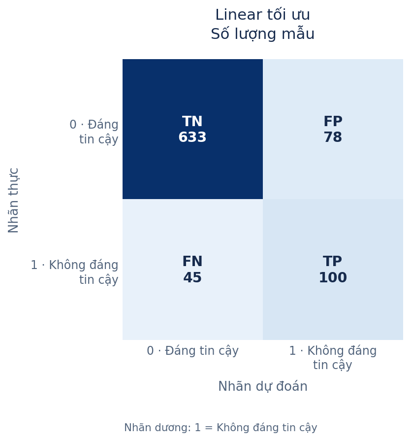

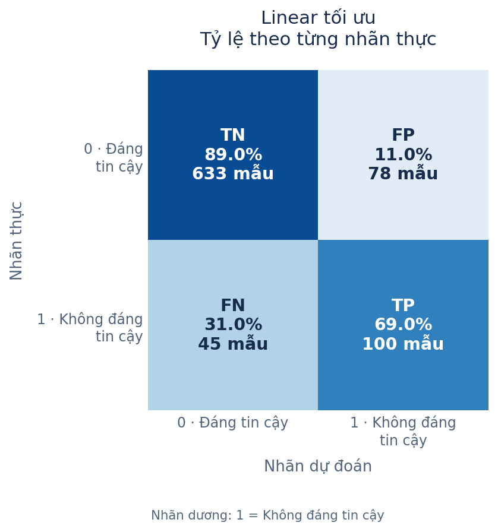

[Dự đoán từng mẫu](predictions/svm_linear_tuned.csv) · [Các mẫu dự đoán sai](predictions/svm_linear_tuned_errors.csv) · [Mô hình .pkl](../artifacts/svm_linear_best.pkl)

### RBF tối ưu

Tham số: `kernel=rbf; C=10.0; gamma=0.01; class_weight=balanced`.

| Nhãn / cách lấy trung bình | Precision | Recall | F1 | Support |
|---|---:|---:|---:|---:|
| 0 · Đáng tin cậy | 93.73% | 86.22% | 89.82% | 711 |
| 1 · Không đáng tin cậy | 51.49% | 71.72% | 59.94% | 145 |
| Trung bình macro | 72.61% | 78.97% | 74.88% | 856 |
| Trung bình có trọng số | 86.57% | 83.76% | 84.76% | 856 |

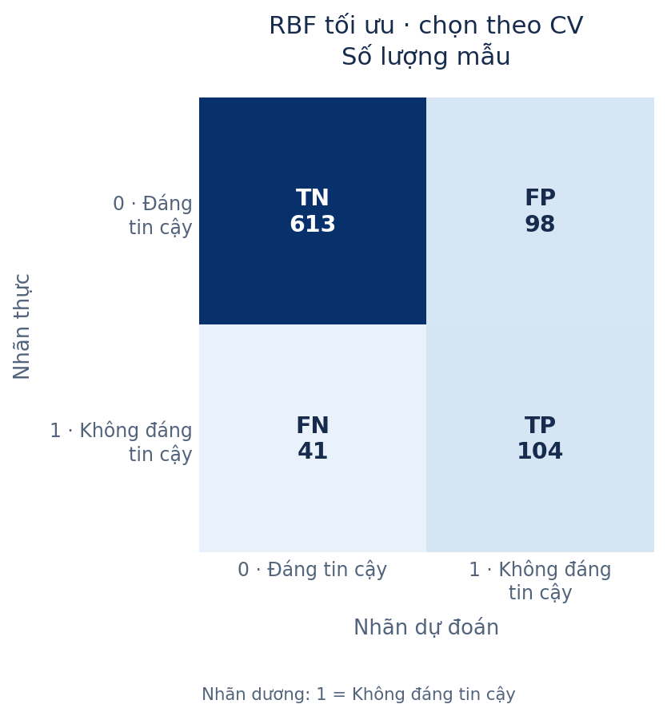

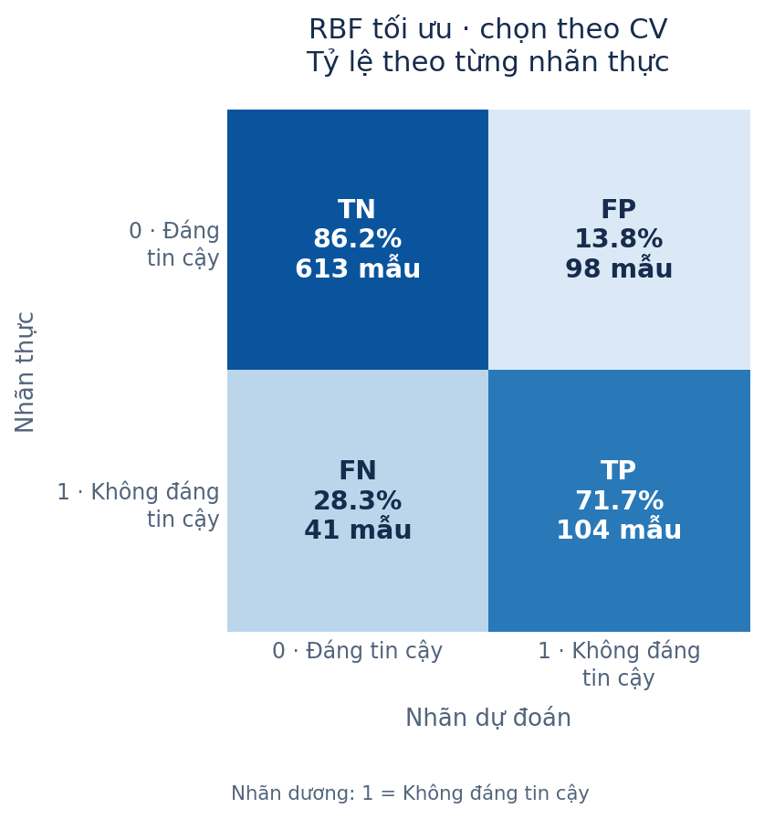

[Dự đoán từng mẫu](predictions/svm_rbf_tuned.csv) · [Các mẫu dự đoán sai](predictions/svm_rbf_tuned_errors.csv) · [Mô hình .pkl](../artifacts/svm_rbf_best.pkl)


## 6. Cách tính các chỉ số

- Accuracy = (TN + TP) / (TN + FP + FN + TP).
- Precision nhãn 1 = TP / (TP + FP).
- Recall nhãn 1 = TP / (TP + FN).
- F1 nhãn 1 = 2 × Precision × Recall / (Precision + Recall).
- F1 macro là trung bình F1 hai nhãn; F1 weighted có trọng số theo số mẫu từng nhãn.
- Balanced accuracy là trung bình Recall hai nhãn. Khi mẫu số bằng 0, Precision / Recall / F1 được quy ước là 0.

Nhãn ReINTEL mô tả đáng tin cậy / không đáng tin cậy của bài đăng. Kết quả này phản ánh khả năng phân loại theo nhãn của bộ dữ liệu.

## 7. Tệp đầu ra và tái lập

- [Bảng chỉ số hiệu năng](tables/model_metrics.csv)
- [Báo cáo phân loại chi tiết](tables/classification_report.csv)
- [Bảng TN / FP / FN / TP](tables/confusion_matrices.csv)
- [Danh sách dòng test bị loại](tables/test_data_audit.csv)
- [Tập test sau kiểm tra](tables/evaluated_test_samples.csv)
- [Văn bản train có nhãn mâu thuẫn](tables/train_label_conflicts.csv)
- [Toàn bộ dự đoán của bốn cấu hình](predictions/all_predictions.csv)
- [Kết quả đầy đủ và thông tin tái lập](evaluation_summary.json).
- [Báo cáo HTML ngoại tuyến](index.html).
- `figures/`: mỗi biểu đồ có bản PNG và SVG; tên tệp ma trận chứa ID cấu hình.
- `predictions/`: dự đoán từng mẫu và các mẫu sai cho từng cấu hình.

CSV ghi UTF-8 có BOM để mở trong Excel. PNG phù hợp cho báo cáo và slide; SVG giữ độ nét khi phóng to.

Chạy lại từ thư mục gốc dự án:

```powershell
.\.venv\Scripts\python.exe run_evaluation.py
```

Phiên bản thư viện: {"python": "3.11.16", "scikit_learn": "1.7.2", "numpy": "2.3.3", "pandas": "2.3.2", "joblib": "1.5.2"}.
