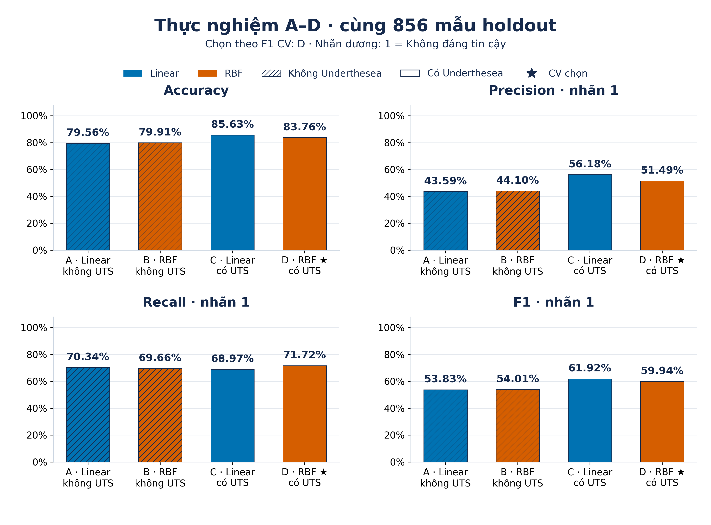
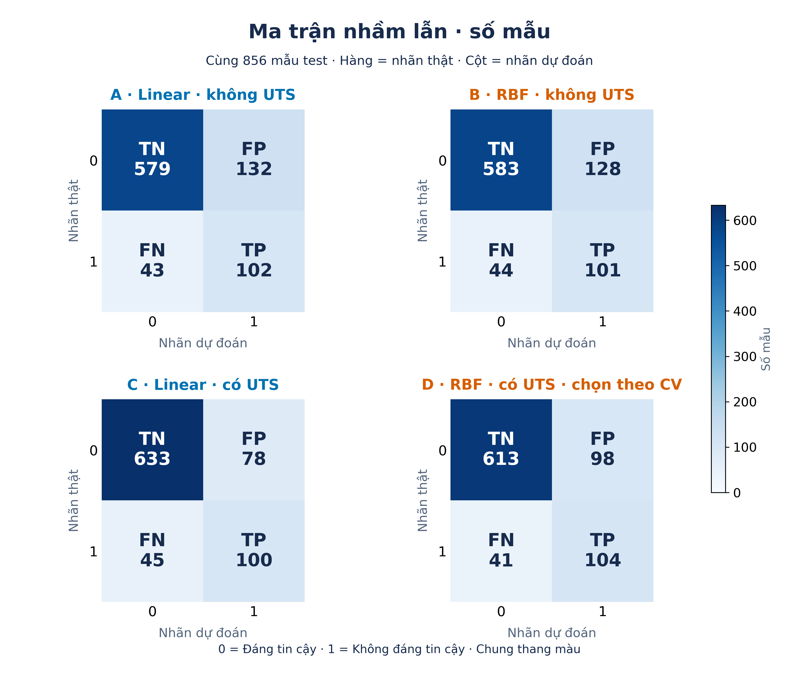
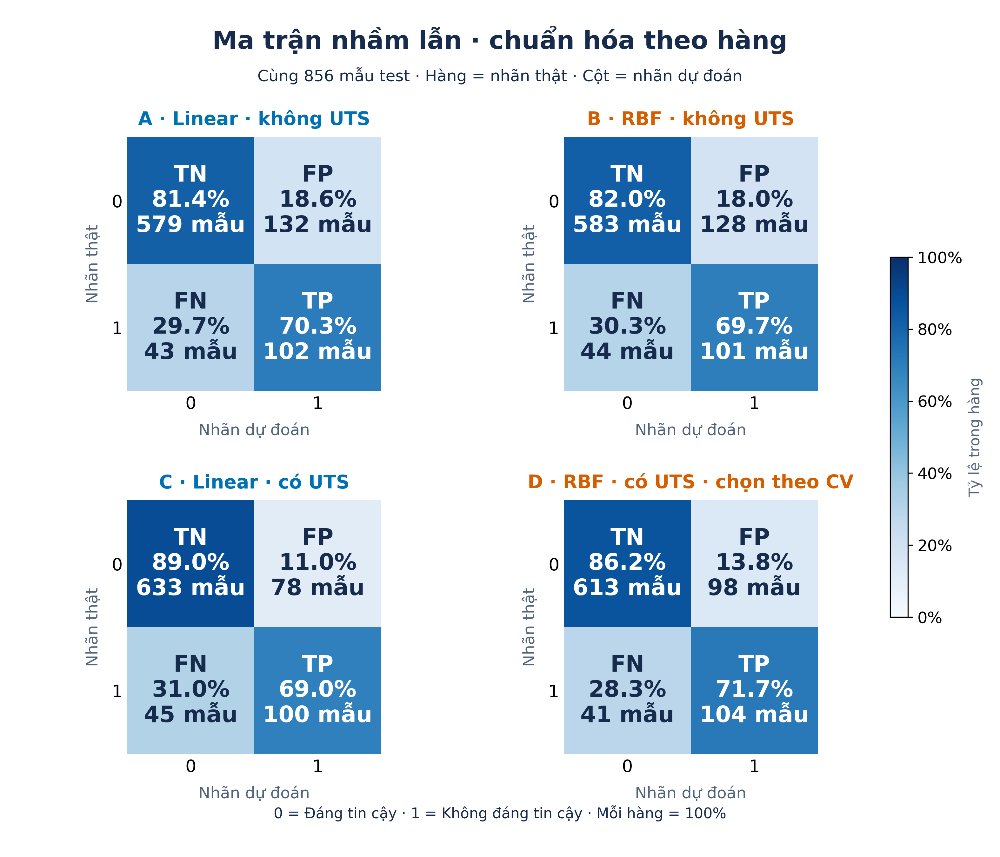
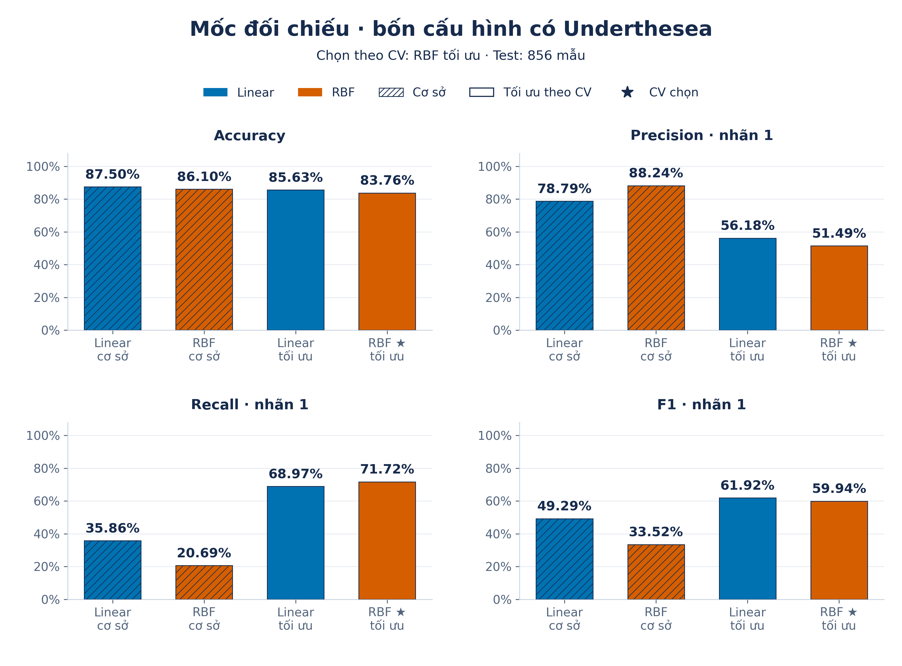
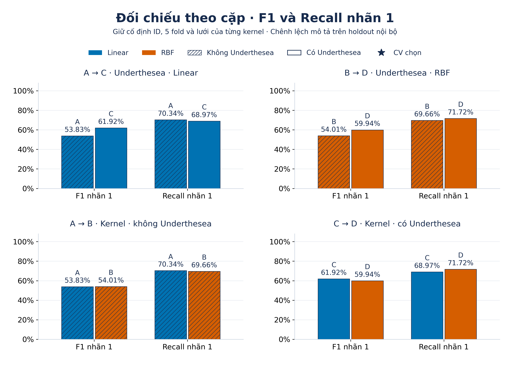
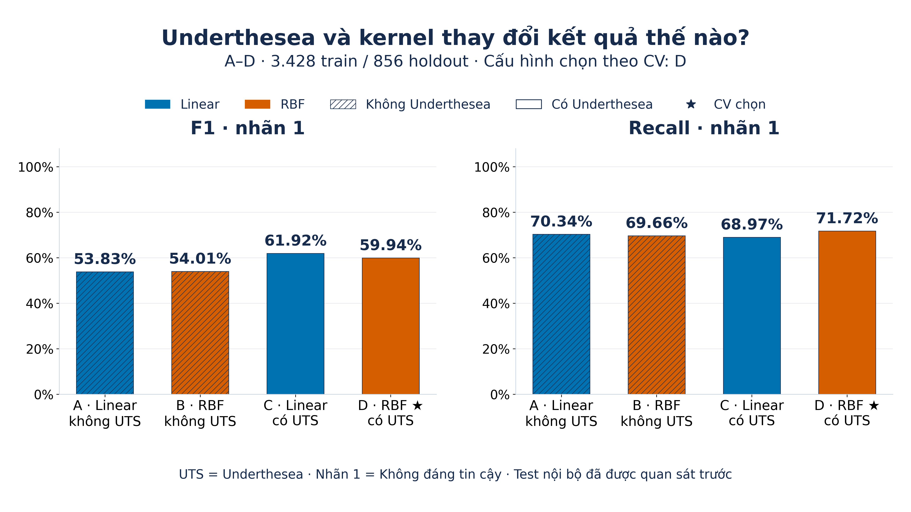

# Chương 3–4 · Thực nghiệm SVM–TF-IDF trên ReINTEL

Kết quả thực tế: 2026-11-14T17:00:01.624442+07:00. [Mở báo cáo HTML](chapter3_4.html) · [Mốc cơ sở/tối ưu có Underthesea](index.html) · [CSV A–D](../results/chapter3_4/metrics_abcd.csv).

## 3.1. Dữ liệu và phạm vi thực nghiệm

Nguồn: ReliableAI/ReINTEL, bản dữ liệu và revision đã ghi trong [metadata](../data/raw/reintel_metadata.json). CSV thô có 4.372 bài đăng. Quy trình chuẩn bị trước đó loại dòng thiếu/rỗng hoặc trùng cặp văn bản–nhãn, giữ 4.290 dòng; tiếp tục loại 4 văn bản rỗng sau làm sạch, còn 4.286 bản ghi để chia 3.428 train và 858 test. Lần đánh giá trước loại 2 mẫu test trùng văn bản sau phân đoạn, giữ 856 mẫu (711 nhãn 0; 145 nhãn 1). Lần này giữ nguyên các ID đó, không lấy mẫu lại. [Danh sách test](../results/chapter3_4/holdout_ids.csv), [ID và fold train](../results/chapter3_4/cv_fold_assignments.csv), [kiểm tra dữ liệu](../results/chapter3_4/data_audit.json) và hash đầu vào trong [JSON thực nghiệm](../results/chapter3_4/experiment_summary.json) cho phép đối chiếu.

| Tập | Số mẫu | Nhãn 0 | Nhãn 1 | Ký tự gốc TB | Ký tự sạch TB | Đơn vị khoảng trắng TB |
|---|---|---|---|---|---|---|
| raw | 4372 | 3638 | 734 | 747.9 | 740.3 | 162.6 |
| train | 3428 | 2851 | 577 | 739.8 | 732.0 | 160.5 |
| holdout | 856 | 711 | 145 | 807.7 | 800.8 | 177.0 |

Độ dài đo bằng ký tự của chuỗi Python, bỏ văn bản thiếu khi tính trung bình (raw có 4.371 văn bản không thiếu); đơn vị khoảng trắng là số phần tử sau split trên văn bản sạch, không phải số từ ngôn ngữ học hoặc token của TF-IDF. source_index là vị trí dòng từ 0 trong CSV gốc của dự án, không khẳng định là ID bài đăng nguyên thủy của ReINTEL. [CSV thống kê](../results/chapter3_4/dataset_statistics.csv) và [kiểm tra các bước chuẩn bị](../results/chapter3_4/preparation_audit.json).

Nhãn 0 = reliable (đáng tin cậy), nhãn 1 = unreliable (không đáng tin cậy). Đây là nhãn bài đăng của bộ dữ liệu, không phải kết quả kiểm chứng sự thật do mô hình tạo ra. Train giữ nguyên 4 dòng lặp sau làm sạch và 1 nhóm có nhãn mâu thuẫn; các nhóm không bị tách qua ranh giới fold. Giữ nguyên nhãn để đối chiếu mốc cũ, không tự sửa nhãn dựa trên dự đoán.

## 3.2. Môi trường và công cụ

CPU: 11th Gen Intel(R) Core(TM) i5-1135G7 @ 2.40GHz; 4 lõi vật lý, 8 luồng; RAM máy 11.70 GiB (12,564,480,000 byte). Hệ điều hành Windows-10-10.0.26100-SP0. Python 3.11.16. Grid Search chạy n_jobs=2, SVC cache_size=256 MiB mỗi tác vụ. Đây là ngân sách cache, không phải số đo RAM thực dùng của mô hình.

Phiên bản thực chạy: {"scikit-learn": "1.7.2", "numpy": "2.3.3", "pandas": "2.3.2", "scipy": "1.17.1", "underthesea": "8.3.0", "matplotlib": "3.10.6", "joblib": "1.5.2", "psutil": "7.2.2"}. [Phụ thuộc trực tiếp](../requirements.txt) và [phụ thuộc đầy đủ của môi trường](../results/chapter3_4/environment_freeze.txt).

## 3.3. Pipeline và chống rò rỉ

Đối chiếu Bảng 2.1 ở trang in 31 (trang PDF 39) của báo cáo giữa kỳ: A = không Underthesea + Linear; B = không Underthesea + RBF; C = Underthesea + Linear; D = Underthesea + RBF. Các ID và nhãn train/test khớp dữ liệu nguồn. Không có văn bản sau clean_text trùng chính xác giữa train/test, hoặc giữa train/validation trong từng fold. Kiểm tra cũng xác nhận không trùng chuỗi đã phân đoạn qua từng fold. Nhóm gần trùng được khảo sát riêng ở mục 4.4.

Làm sạch thống nhất: chuẩn hóa NFC, giải mã HTML entity, xóa thẻ HTML, bỏ URL, chuyển chữ thường và gom khoảng trắng. Giữ dấu tiếng Việt, phủ định, dấu câu và emoji ở bước cleaning. C/D tiếp tục gọi Underthesea format="text" để nối từ ghép bằng dấu gạch dưới.

Đính chính cách gọi nhánh A/B: TF-IDF dùng analyzer="word", token_pattern=`(?u)\b\w+\b`, lowercase=False. Regex lấy các dãy ký tự Unicode thuộc lớp từ (gồm chữ, số và gạch dưới), giữ token một ký tự; dấu câu làm ranh giới. Ví dụ `học sinh, a 12 học_sinh!` cho token `học`, `sinh`, `a`, `12`, `học_sinh`. A/B không phân đoạn từ ghép tiếng Việt và không phải phép split theo khoảng trắng thuần túy. Dấu câu và emoji không được regex đưa vào đặc trưng dù cleaning giữ chúng.

TF-IDF chung: unigram (1,1), max_features=10.000, min_df=1, max_df=1.0, norm=l2, use_idf=True, smooth_idf=True, sublinear_tf=False, không stopword/stemming. Pipeline TF-IDF → SVC được clone và fit riêng trong mỗi lượt CV; vocabulary và IDF chỉ học từ phần train của fold. Cấu hình đã chọn được refit trên toàn bộ 3.428 train; holdout chỉ transform và dự đoán. SVC dùng probability=False, decision_function có hướng dương về classes_[1]=1; ROC-AUC tính từ điểm liên tục này.

Tái sử dụng nguyên 5 fold StratifiedGroupKFold seed=42 từ mốc cũ; đã kiểm tra khóa nội dung clean_text độc lập với Underthesea hợp lệ trên chính phân hoạch đó. Không tạo lại fold theo từng nhánh. Các fold có kích thước gần nhau và tỷ lệ nhãn không hoàn toàn bằng nhau:

| Fold | Train 0 | Train 1 | Validation 0 | Validation 1 | Tổng validation |
|---|---|---|---|---|---|
| 1 | 2273 | 468 | 578 | 109 | 687 |
| 2 | 2290 | 454 | 561 | 123 | 684 |
| 3 | 2267 | 476 | 584 | 101 | 685 |
| 4 | 2298 | 445 | 553 | 132 | 685 |
| 5 | 2276 | 465 | 575 | 112 | 687 |

## 3.4. Grid Search, lựa chọn và refit

Linear: C ∈ {0.1, 1, 10, 100}, class_weight ∈ {None, balanced}: 8 ứng viên × 5 fold = 40 fit mỗi nhánh. RBF thử thêm gamma ∈ {scale, 0.01, 0.1, 1}: 32 ứng viên × 5 fold = 160 fit mỗi nhánh. Tổng A–D: 400 fit CV và 4 refit; không thu hẹp lưới theo kết quả test. Lưới này theo báo cáo giữa kỳ/pipeline hiện có, rộng hơn lưới dự kiến ban đầu trong đề cương.

Chọn tham số bằng F1 nhãn 1 trung bình không trọng số trên 5 validation fold. SD là độ lệch chuẩn quần thể của 5 điểm fold (ddof=0), không phải khoảng tin cậy và các fold không là 5 thí nghiệm độc lập. Khi hòa điểm, chọn ứng viên đầu theo ParameterGrid; khi hòa giữa kịch bản, ưu tiên thứ tự A/B/C/D. [Bản lựa chọn trước holdout](../results/chapter3_4/selection_before_holdout.json) được lưu trước bước tính chỉ số test. Các CSV grid_search_A/B/C/D giữ điểm từng fold của mọi ứng viên.

## 4.1. Kết quả A–D và mốc đối chiếu

**Cấu hình được chọn theo CV: D**, F1 CV = 0.5934 ± 0.0538. **F1 cao nhất trên test (chỉ mô tả): C**. Không thay cấu hình CV bằng cấu hình thắng test. Accuracy tính trên toàn test; Precision, Recall, F1 dùng pos_label=1, zero_division=0. ROC-AUC dùng decision_function; không dùng nhãn nhị phân thay cho điểm.

| Kịch bản | UTS | Kernel | Tham số chọn trên CV | F1 CV ± SD | Accuracy | Precision₁ | Recall₁ | F1₁ | ROC-AUC | TN/FP/FN/TP |
|---|---|---|---|---|---|---|---|---|---|---|
| A | Không | linear | C=0.1; class_weight=balanced | 0.5685 ± 0.0484 | 0.7956 | 0.4359 | 0.7034 | 0.5383 | 0.8444 | 579/132/43/102 |
| B | Không | rbf | C=10.0; class_weight=balanced; gamma=0.01 | 0.5809 ± 0.0397 | 0.7991 | 0.4410 | 0.6966 | 0.5401 | 0.8514 | 583/128/44/101 |
| C | Có | linear | C=1.0; class_weight=balanced | 0.5869 ± 0.0454 | 0.8563 | 0.5618 | 0.6897 | 0.6192 | 0.8638 | 633/78/45/100 |
| D | Có | rbf | C=10.0; class_weight=balanced; gamma=0.01 | 0.5934 ± 0.0538 | 0.8376 | 0.5149 | 0.7172 | 0.5994 | 0.8571 | 613/98/41/104 |



Ma trận có hàng là nhãn thật, cột là nhãn dự đoán, thứ tự [0,1]. Từng ma trận tổng 856; mỗi hàng lần lượt tổng 711 và 145. Ma trận chuẩn hóa lấy từng ô chia tổng hàng, không chia tổng 856; mỗi hàng cộng 100%. Các hình cùng loại dùng chung giới hạn thang màu.





Bốn cấu hình cũ đều có Underthesea, đối chiếu cơ sở và sau Grid Search. Số liệu được giữ làm mốc, không đổi tên chúng thành A–D:

| Mốc có Underthesea | F1 CV | Accuracy | Precision₁ | Recall₁ | F1₁ |
|---|---|---|---|---|---|
| Linear cơ sở | 0.4957 | 0.8750 | 0.7879 | 0.3586 | 0.4929 |
| RBF cơ sở | 0.3366 | 0.8610 | 0.8824 | 0.2069 | 0.3352 |
| Linear tối ưu | 0.5869 | 0.8563 | 0.5618 | 0.6897 | 0.6192 |
| RBF tối ưu | 0.5934 | 0.8376 | 0.5149 | 0.7172 | 0.5994 |



## 4.2. Ảnh hưởng của Underthesea và kernel

Chênh lệch sau − trước dưới đây dùng đơn vị điểm phần trăm; A→C và B→D thay nhánh phân đoạn, A→B và C→D thay kernel. Dù cách tách token là biến thiết kế, mỗi kịch bản chọn siêu tham số riêng trên CV nên đây là hiệu quả của pipeline đã tối ưu, không phải phép đo tokenizer thuần túy tại C/gamma cố định.

| Cặp (sau − trước) | Yếu tố | Δ F1 CV | Δ Accuracy | Δ Precision₁ | Δ Recall₁ | Δ F1₁ | Δ AUC |
|---|---|---|---|---|---|---|---|
| A→C | Underthesea | +1.84 | +6.07 | +12.59 | -1.38 | +8.09 | +1.94 |
| B→D | Underthesea | +1.24 | +3.86 | +7.38 | +2.07 | +5.93 | +0.57 |
| A→B | kernel | +1.24 | +0.35 | +0.52 | -0.69 | +0.18 | +0.70 |
| C→D | kernel | +0.65 | -1.87 | -4.69 | +2.76 | -1.98 | -0.68 |

A→C: F1 nhãn 1 thay đổi +8.09 điểm phần trăm; Recall -1.38; ROC-AUC +1.94. Đây là đối chiếu các cấu hình được tối ưu riêng theo cùng giao thức, không cô lập riêng tác động của tokenizer ở một bộ siêu tham số cố định.
B→D: F1 nhãn 1 thay đổi +5.93 điểm phần trăm; Recall +2.07; ROC-AUC +0.57. Đây là đối chiếu các cấu hình được tối ưu riêng theo cùng giao thức, không cô lập riêng tác động của tokenizer ở một bộ siêu tham số cố định.
A→B: F1 nhãn 1 thay đổi +0.18 điểm phần trăm; Recall -0.69; ROC-AUC +0.70. Đây là đối chiếu các cấu hình được tối ưu riêng theo cùng giao thức, không cô lập riêng tác động của tokenizer ở một bộ siêu tham số cố định.
C→D: F1 nhãn 1 thay đổi -1.98 điểm phần trăm; Recall +2.76; ROC-AUC -0.68. Đây là đối chiếu các cấu hình được tối ưu riêng theo cùng giao thức, không cô lập riêng tác động của tokenizer ở một bộ siêu tham số cố định.

Các chênh lệch trên một holdout không đủ để khẳng định ưu thế ổn định hoặc ý nghĩa thống kê. Không kiểm định t-test trên 5 fold có tập train chồng lấn; không gọi SD fold là CI. Cần chia theo sự kiện/nguồn hoặc test ngoài và lặp thực nghiệm để kiểm tra khả năng khái quát.



## 4.3. Chi phí huấn luyện và suy luận

Đo bằng perf_counter. Tiền xử lý đo lại từ nội dung gốc theo từng nhánh, gồm cleaning và (nếu có) segmentation; không tính I/O, audit ban đầu hoặc việc nạp thư viện. A/B dùng chung phép tiền xử lý không Underthesea; C/D dùng chung phép tiền xử lý Underthesea, không cộng hai lần cùng số đo. Grid Search refit=False, nên thời gian tìm lưới và refit toàn train được đo tách biệt; chi phí kiểm tra/lưu .pkl không nằm trong refit.

| Nhánh | Tiền xử lý 3.428 train (s) | Tiền xử lý 856 test (s) |
|---|---|---|
| no_underthesea | 0.374 | 0.092 |
| underthesea | 58.388 | 19.735 |

| Kịch bản | Grid Search (s) | Refit (s) | Pipeline (ms/mẫu) | SD (ms/mẫu) | Toàn luồng (ms/mẫu) | Tệp (MiB) |
|---|---|---|---|---|---|---|
| A | 100.983 | 9.702 | 2.725 | 0.175 | 2.717 | 1.998 |
| B | 428.244 | 5.332 | 2.386 | 0.155 | 2.961 | 1.795 |
| C | 66.820 | 3.215 | 1.322 | 0.097 | 19.305 | 1.162 |
| D | 432.233 | 5.398 | 2.128 | 0.326 | 19.806 | 1.476 |

Benchmark suy luận dùng đúng 128 ID đầu của holdout theo thứ tự đã lưu, batch=64 (2 batch/lượt), 5 lần lặp và 1 batch warm-up trước mỗi cấu hình. Pipeline = TF-IDF.transform + SVC.predict trên chuỗi đã tiền xử lý. Toàn luồng = cleaning + segmentation nếu có + pipeline; không bao gồm I/O, nạp mô hình hay decision_function. Giá trị chính là median ms/mẫu của 5 lượt, SD tính từ cùng 5 lượt. [Các ID benchmark](../results/chapter3_4/benchmark_ids.csv) và toàn bộ thời gian từng lượt nằm trong JSON. Mỗi cấu hình dùng cùng văn bản và batching; benchmark chạy tuần tự sau khi hoàn thành mọi Grid Search.

RAM máy là thông số phần cứng. Cột tệp là kích thước .pkl nén joblib compress=3 trên đĩa (MiB = 2²⁰ byte); **chưa đo RAM mô hình sử dụng khi chạy** nên không suy diễn RAM từ kích thước tệp. Thời gian là phép đo trên một máy, chịu ảnh hưởng cache, tải nền và thứ tự A–D; không phải benchmark đa máy hoặc bảo đảm độ trễ triển khai.

## 4.4. Kiểm tra gần trùng và giới hạn holdout

Phân tích độ nhạy dùng TF-IDF ký tự char_wb, ngram=(3,5), max_features=50.000, vocabulary/IDF chỉ fit trên train; tìm láng giềng train gần nhất cho mỗi test bằng cosine. Với từng ngưỡng 0.80/0.90/0.95, bỏ khỏi phần thống kê các test có cosine ≥ ngưỡng, giữ nguyên mô hình và dự đoán, không retune. [Từng cặp ID và cosine](../results/chapter3_4/near_duplicate_pairs.csv) được công bố. Đây là độ giống từ vựng xấp xỉ, chưa xác nhận cùng sự kiện hoặc cùng nguồn; ngưỡng là phân tích thăm dò, không là tiêu chí chọn mô hình.

| Ngưỡng cosine ≥ | Kịch bản | Loại | Giữ | Số nhãn 1 | F1₁ | Recall₁ | ROC-AUC |
|---|---|---|---|---|---|---|---|
| 0.8 | A | 53 | 803 | 132 | 0.5233 | 0.6818 | 0.8355 |
| 0.8 | B | 53 | 803 | 132 | 0.5279 | 0.6818 | 0.8431 |
| 0.8 | C | 53 | 803 | 132 | 0.5966 | 0.6667 | 0.8525 |
| 0.8 | D | 53 | 803 | 132 | 0.5815 | 0.6894 | 0.8479 |
| 0.9 | A | 34 | 822 | 136 | 0.5254 | 0.6838 | 0.8381 |
| 0.9 | B | 34 | 822 | 136 | 0.5314 | 0.6838 | 0.8463 |
| 0.9 | C | 34 | 822 | 136 | 0.6073 | 0.6765 | 0.8579 |
| 0.9 | D | 34 | 822 | 136 | 0.5901 | 0.6985 | 0.8517 |
| 0.95 | A | 26 | 830 | 137 | 0.5281 | 0.6861 | 0.8405 |
| 0.95 | B | 26 | 830 | 137 | 0.5341 | 0.6861 | 0.8484 |
| 0.95 | C | 26 | 830 | 137 | 0.6098 | 0.6788 | 0.8599 |
| 0.95 | D | 26 | 830 | 137 | 0.5926 | 0.7007 | 0.8537 |

Ở ngưỡng 0.80, giữ 803 mẫu, loại 53; F1 nhãn 1 của cấu hình CV D là 0.5815, thay đổi -1.80 điểm phần trăm so với holdout đầy đủ.

Tập kiểm thử là phần chia nội bộ từ split train công khai của ReINTEL. Điểm test đã được quan sát trong báo cáo cũ và nay được sử dụng lại để đối chiếu, vì vậy không gọi đây là một test ngoài hoàn toàn chưa từng nhìn thấy. Nhóm dữ liệu cùng chủ đề/sự kiện có thể tồn tại qua hai phía dù không trùng chính xác. Sự thay đổi điểm khi lọc gần trùng còn chịu thay đổi kích thước, tỷ lệ lớp và độ khó của tập còn lại; không chứng minh toàn bộ chênh lệch là rò rỉ. Chưa có test độc lập theo thời gian, sự kiện hoặc nguồn đăng.

## 4.5. Phân tích FP/FN thực tế

Các ví dụ được chọn bằng quy tắc xác định trước trên cấu hình CV D: 2 FP và 2 FN có |decision_function| nhỏ nhất, cùng 2 FP và 2 FN có |score| lớn nhất trong từng loại lỗi. “Xa” là xa tương đối trong lỗi của chính mô hình đó, không phải xác suất hoặc độ tin cậy đã hiệu chuẩn; không so trực tiếp độ lớn điểm của kernel khác nhau. Nội dung đầy đủ trong [CSV ví dụ lỗi](../results/chapter3_4/error_examples.csv); nhận xét thủ công riêng trong [CSV chú giải](../results/chapter3_4/error_annotations.csv). Nhận xét dựa trên câu chữ, không xác minh tính đúng sai của bài đăng và không kết luận nhãn gốc sai.

### FP · ID 359 · sát ngưỡng

Nhãn thật 0; dự đoán 1; decision_function = +0.007391.

Nội dung (trích, có thể rút gọn): Tôi cũng vài lần rơi vào trạng thái đãng trí, bất cẩn với các con. Lần nào tôi cũng ân hận 'giá như...' nhưng rồi áp lực cuộc sống lại kéo tôi vào một cái bẫy khác.

Nhận xét: Đoạn tự sự về đãng trí và ân hận trong chăm sóc con; không chứa dấu hiệu nguồn tin hoặc mệnh đề kiểm chứng rõ trong phần chữ. Điểm +0.0074 rất sát ngưỡng nên đây là lỗi biên của mô hình; nội dung ngắn và thiếu bối cảnh là một giả thuyết định tính, chưa phải nguyên nhân đã được quy thuộc bằng trọng số đặc trưng.
### FP · ID 862 · sát ngưỡng

Nhãn thật 0; dự đoán 1; decision_function = +0.008956.

Nội dung (trích, có thể rút gọn): Bài học cho người nào còn có ý định đăng tin sai sự thật lên Facebook ... <URL>

Nhận xét: Bài cảnh báo hậu quả của việc đăng tin sai sự thật, có cụm 'tin sai sự thật' nhưng không khẳng định người viết đang truyền tin đó. TF-IDF unigram không biểu diễn trực tiếp vai trò cảnh báo hoặc trích dẫn. URL bị loại trong cleaning; phần nội dung còn lại ngắn. Đây là giả thuyết về khó khăn ngữ cảnh, không phải bằng chứng rằng riêng cụm từ này gây ra dự đoán.
### FP · ID 1042 · xa ngưỡng

Nhãn thật 0; dự đoán 1; decision_function = +2.376774.

Nội dung (trích, có thể rút gọn): Tình hình thấy Thanh Hoá có người được xác nhận là đã có 1 trường hợp dương tính với loại virus mới n2019CoV. Cũng nhân tiện thầy mình giục viết bài về kết quả nghiên cứu em coronavirus mình làm trong mấy năm qua nên quyết định tranh thủ lúc nghỉ giải lao ngoi lên FB viết 1 bài chia sẻ về những thông tin cơ bản cho mọi người ở nhà để mọi người có thêm nguồn thông tin phòng tránh bệnh, không tin vào những tin lá cải, câu view trên FB và bớt lo lắng hơn về căn bệnh mới này. Ngà...y 30/01/2020, tổ chức y tế thế giới (WHO) sau 2 lần họp khẩn cấp về sự kiện virus corona gây bệnh viêm phổi có nguồn gốc từ Vũ Hán (Trung Quốc) đã chính thức tuyên bố tình trạng khẩn cấp về sức khoẻ y tế công cộng trên thế giới (PHEIC) vì loại virus này. Nguồn thông tin: Tiếng Anh: <URL>…/30-01-2020-statement-on-the-second-me… Tiếng Việt: <URL> Tình hình diễn biến bệnh, số liệu cập nhập liên tục về số ca mắc bệnh, tử vong và được chữa khỏi mọi người có thể cập nhập ở trên trang web được lập ra bởi trung tâm nghiên cứu từ trường đại học Johns Hopkins của Mỹ. <URL>…/opsdashboa…<URL>… Hiện nay ngoài 2 trường hợp  […]

Nhận xét: Bài giải thích rất dài về coronavirus, dẫn WHO và các nguồn nghiên cứu, đan xen thuật ngữ y tế, thông tin dịch bệnh, phủ định và cảnh báo tin lá cải. Nhãn gốc là 0 nhưng điểm dương lớn nhất trong các FP. Trường hợp này cho thấy điểm xa ngưỡng vẫn có thể sai theo nhãn; có thể khảo sát sự lẫn lộn giữa chủ đề y tế và ngữ cảnh giải thích. Chưa quy thuộc nguyên nhân bằng phân tích đặc trưng và không xác minh các phát biểu y tế trong bài.
### FP · ID 1991 · xa ngưỡng

Nhãn thật 0; dự đoán 1; decision_function = +2.082847.

Nội dung (trích, có thể rút gọn): Anaferon - Viên tăng sức đề kháng - SAIIIIIIIII  Tôi nói SAI vì nó không phải sản phẩm tăng sức đề kháng. Tôi ngồi khám bệnh, thi thoảng có bệnh nhân cần điều trị, tôi kê Anaferon. Bệnh nhân hỏi lại, bác ơi, có phải cái tăng đề kháng hình con chym cánh cụt không ? Tôi lại giải thích, nó không phải em ạ. Rồi bệnh nhân khác lại hỏi, tôi lại nói. Dần dà, nhiều người hiểu sai quá, tôi mỏi mồm, chả giải thích nữa.  Rồi tôi tra google, nhan nhản các chỗ đều gắn cho nó cái mác tăng ...sức đề kháng, tăng cường miễn dịch. Nhìn chung, tăng sức đề kháng thì nó cũng mông lung, gắn cái mác vào  thì dễ bán hàng hơn. Nhưng giờ đây nó phổ biến quá, nên cần hiểu về nó đúng hơn.  Anaferon là tên thương mại. Thành phần chính của nó là kháng thể kháng Interferon. Nó là một loại kháng thể, góp phần chống lại các loại virus gây bệnh cho cơ thể. Tất nhiên, chỉ là thêm mắm thêm muối. Tuỳ vào tình trạng bệnh, nếu dùng đúng, đúng cách, đúng thời gian thì nó có vẻ có tác dụng khá tốt. Nhưng bản thân người kê đơn cũng phải hiểu nó là gì để mà áp dụng.  Vì nó là một loại kháng thể, bổ sung vào để cùng cơ thể chố […]

Nhận xét: Bài bàn về Anaferon với nhiều chữ in hoa, từ phủ định, 'SAI' và phản bác cách quảng bá sản phẩm. Nội dung vừa thuật lại quan điểm vừa phủ định quan điểm khác; biểu diễn unigram không giữ đầy đủ quan hệ lập luận. Nhãn gốc là 0 nhưng điểm +2.0828 xa ngưỡng. Đây là quan sát lỗi và giả thuyết ngữ cảnh, không phải xác nhận hiệu quả thuốc hoặc xác định phát biểu nào đúng.
### FN · ID 2799 · sát ngưỡng

Nhãn thật 1; dự đoán 0; decision_function = -0.011073.

Nội dung (trích, có thể rút gọn): Khi các thày thuốc phải lựa chọn cứu chữa những người có cơ hội sống sót  cao hơn, những người già trong các viện dưỡng lão phải đón nhận cái  chết! Thật đáng thương!  

Nhận xét: Một bình luận cảm xúc về lựa chọn cứu chữa và người cao tuổi, không có thời gian hoặc nguồn cụ thể trong văn bản. Nhãn gốc 1 nhưng điểm âm rất nhỏ. Thiếu ngữ cảnh để đánh giá nội dung bằng riêng đoạn chữ; không suy diễn rằng câu cảm thán tự nó là tin sai.
### FN · ID 3206 · sát ngưỡng

Nhãn thật 1; dự đoán 0; decision_function = -0.017400.

Nội dung (trích, có thể rút gọn): Tại sao CSGT lại cứ đè cái lỗi mua bảo hiểm và lỗi phí cầu đường ra để phạt? Nó liên quan đến túi tiền của bên thứ 3 chứ liên quan đ** gì đến an toàn giao thông?

Nhận xét: Câu hỏi tu từ, có từ tục và bình luận về việc xử phạt bảo hiểm/phí đường bộ. Phần chữ không trình bày bằng chứng hoặc tình huống cụ thể. Điểm -0.0174 gần ngưỡng; unigram khó thể hiện mục đích phản vấn và quan hệ giữa các lập luận. Không kết luận chính sách hoặc nhãn gốc đúng/sai chỉ từ ví dụ này.
### FN · ID 2706 · xa ngưỡng

Nhãn thật 1; dự đoán 0; decision_function = -1.216814.

Nội dung (trích, có thể rút gọn): Chuyên gia khuyên dùng thức uống thảo mộc phòng chống virus Covid-19  Một trong các thành phần của bài thuốc sử dụng phòng, chống covid 19 có trong trà thanh nhiệt <URL> 

Nhận xét: Bài có cấu trúc giới thiệu thức uống thảo mộc, gắn lời khuyên 'chuyên gia' với công dụng phòng chống Covid-19 và dẫn URL. Nhãn gốc 1 nhưng điểm -1.2168 là FN xa ngưỡng nhất. Kiểu dẫn thẩm quyền và ngôn ngữ giới thiệu sản phẩm có thể là hướng cần kiểm tra thêm; mô hình chữ không xác minh được chuyên gia, sản phẩm hoặc bằng chứng cho công dụng được nêu.
### FN · ID 4363 · xa ngưỡng

Nhãn thật 1; dự đoán 0; decision_function = -1.216266.

Nội dung (trích, có thể rút gọn): Tin từ Phó Chủ Tịch UBND TPHCM Lê Thanh Liêm. TP Hồ Chí Minh mắc 43000 ca Covid-19, tử vong hơn 1000 ca. 

Nhận xét: Bài ngắn dẫn tên và chức danh lãnh đạo, kèm số ca mắc/tử vong, có hình thức giống thông báo tin tức. Nhãn gốc 1 nhưng mô hình cho điểm âm xa ngưỡng. Văn bản không có thời điểm hoặc tài liệu nguồn đủ để kiểm chứng các con số; ví dụ nêu giới hạn của phân loại theo hình thức câu chữ, không xác nhận thông tin dịch tễ trong bài.

## Tệp cho bản in, slide và tái lập

Bản in: metric_comparison (mốc cũ), abcd_metric_comparison, abcd_pairwise_comparison và các confusion_overview. Mỗi hình có PNG nền trắng 300 DPI và SVG nền trắng với chữ chuyển thành đường nét để giữ dấu tiếng Việt trên máy khác; cùng font DejaVu Sans. Kích thước trang xuất được ghi trong từng .export.json. Không gán chuẩn xuất bản của một tạp chí cụ thể; khi đặt hình 2×2 nên dùng chiều rộng toàn trang và ưu tiên SVG.



[SVG slide 16:9](figures/abcd_slide_16x9.svg) · [CSV đầy đủ](../results/chapter3_4/metrics_abcd.csv) · [So sánh cặp](../results/chapter3_4/pairwise_comparisons.csv) · [Phân tích độ nhạy](../results/chapter3_4/near_duplicate_sensitivity.csv).

```powershell
.\.venv\Scripts\python.exe -X utf8 run_experiments.py --n-jobs 2
.\.venv\Scripts\python.exe -X utf8 run_evaluation.py --no-render
.\.venv\Scripts\python.exe -X utf8 finalize_experiment.py
.\.venv\Scripts\python.exe -X utf8 run_visuals.py
.\.venv\Scripts\python.exe -X utf8 verify_delivery.py --staging tmp/visuals_review
# Mở và kiểm tra PNG/SVG trong tmp/visuals_review trước khi xuất bản.
.\.venv\Scripts\python.exe -X utf8 run_visuals.py --publish
.\.venv\Scripts\python.exe -X utf8 verify_delivery.py
.\.venv\Scripts\python.exe -X utf8 -m unittest discover -s tests -v
```

## Công cụ trực quan hóa và tài liệu tham khảo

Đã dùng scientific-visualization của K-Dense để thiết kế, kiểm tra thang đo, màu dự phòng bằng họa tiết, xuất bản in/slide và kiểm tra metadata; tiếp tục dùng Matplotlib của dự án. Theo yêu cầu dẫn nguồn của skill: Kassis, T., Agarwal, V., He, Y., Patel, D., & Brueckner, A. M. (2026). Scientific Agent Skills: A Library of Procedural Knowledge for Research Agents. [arXiv:2609.00065](https://doi.org/10.48550/arXiv.2609.00065). Metadata tác giả/năm đã đối chiếu bản arXiv hiện hành ngày 14/11/2026; không có journal DOI được ghi ở trang nguồn lúc kiểm tra.
